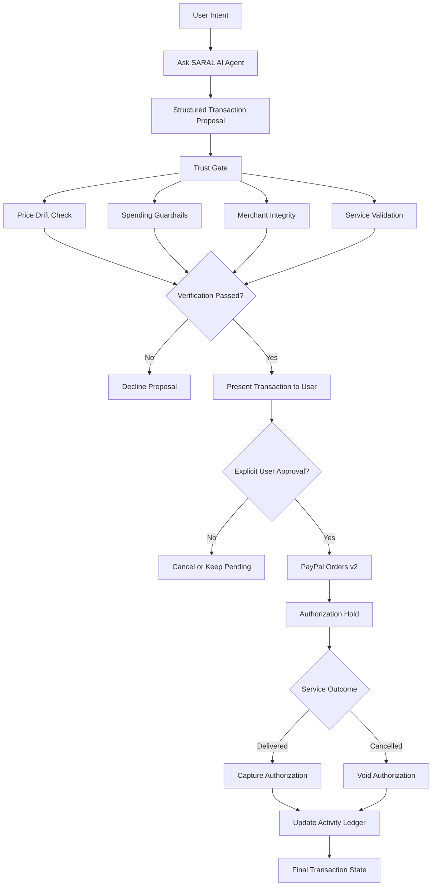
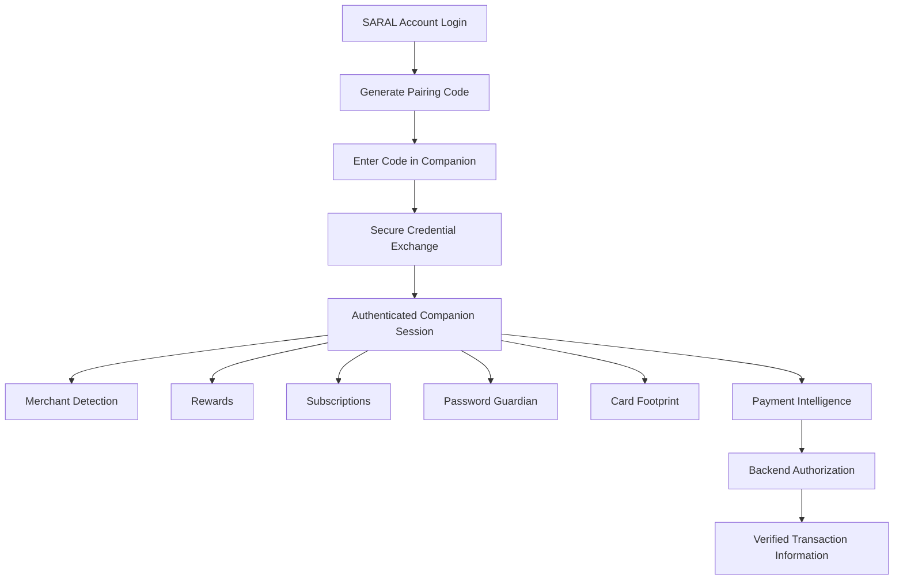

# SARAL
### AI-Powered Digital Services Ecosystem with PayPal Trust Gate

**One intelligent interface. Multiple everyday services. Transparent, user-controlled transactions.**

[](LICENSE)
[](https://supabase.com/)
[](https://developer.paypal.com/)
[](https://nodejs.org/)
[](https://developer.chrome.com/docs/extensions/)
[](https://developer.mozilla.org/en-US/docs/Web/JavaScript)

---

## 1. What is SARAL?

SARAL is an AI-powered digital services ecosystem that brings everyday transactions, commerce intelligence and payment management into one connected experience.

Users can interact with an AI agent to discover services, prepare purchases, evaluate transaction details and manage payments through a unified interface.

From cinema bookings and portable power bank rentals to mobile recharges, utility payments and reseller commerce, SARAL aims to simplify fragmented digital experiences.

But SARAL is built around a deeper problem:

**How can AI participate in commerce without receiving unrestricted authority over a user's money?**

Traditional agentic commerce can introduce risks such as unauthorized purchases, price changes, unverified merchants and AI-generated transaction details that users cannot independently validate.

SARAL addresses this through its central innovation: the **PayPal Trust Gate**.

Instead of allowing an AI agent to autonomously charge a payment method, SARAL separates transaction preparation, verification and financial execution.

The AI proposes. The Trust Gate verifies. The user authorizes. PayPal processes.

**AI can help make the decision, but the user remains in control of the money.**

---

## 2. Problems SARAL Addresses

| Problem | SARAL's approach |
|---|---|
| Uncontrolled AI purchases | AI generates structured proposals instead of independently committing payments. |
| Unauthorized financial transactions | Explicit user approval is required before financial execution. |
| Hidden price changes | Trust Gate checks the proposed and final transaction amounts. |
| Unverified merchants | Merchant integrity checks help identify unsupported or untrusted services. |
| Unclear payment states | PayPal authorization, capture and void states are represented in the transaction ledger. |
| Fragmented digital services | Connected mini-apps bring everyday services into one interface. |
| Subscription visibility | Companion provides subscription intelligence from available account records. |
| Limited payment transparency | Payment Intelligence provides transaction visibility and explanations. |
| Lack of browser-level assistance | SARAL Companion extends commerce intelligence into the browser. |
| Unclear financial accountability | Transaction events and Trust Gate decisions are recorded for auditability. |

---

## 3. Product Architecture

SARAL consists of three connected product surfaces.

### A. SARAL Personal Workspace

The Personal Workspace is designed for individuals accessing everyday digital services.

| Feature | Description |
|---|---|
| Ask SARAL AI Agent | Understands conversational requests and prepares structured transaction proposals. |
| Trust Gate | Evaluates merchant, price and spending conditions before payment authorization. |
| PayPal Authorization | Supports an authorization-first payment workflow. |
| Activity Ledger | Tracks transaction events, payment states and Trust Gate decisions. |
| Spending Guardrails | Applies configurable transaction and daily spending limits. |
| Connected Mini-Apps | Provides access to everyday services through a unified experience. |

### B. SARAL Business Reseller Workspace

The Business Workspace provides tools for managing inventory, understanding customers and improving reseller economics.

| Feature | Description |
|---|---|
| Canonical Inventory | Centralized inventory for vintage cameras, audio equipment and refurbished laptops. |
| Buyer Memory CRM | Organizes buyer preferences, purchase history and price tolerance. |
| Marketplace Intelligence | Compares marketplace fees and estimated net proceeds across sales channels. |
| PayPal Checkout | Supports direct PayPal checkout and payment reconciliation. |

Personal and Business Workspaces maintain separate responsibilities and data-access boundaries.

### C. SARAL Companion — Chrome Extension

<badge color="success">Connected browser experience</badge>

SARAL Companion extends the SARAL ecosystem beyond the main web application.

It is a Chrome Manifest V3 extension designed to bring merchant-aware assistance, payment intelligence and personal commerce utilities into the user's browsing experience.

Rather than requiring users to repeatedly open the main SARAL application, Companion provides contextual access to relevant information while they browse.

**Core capabilities**

| Feature | Description |
|---|---|
| Secure Pairing | Connects the extension to an authenticated SARAL account through a dedicated pairing flow. |
| Merchant Detection | Identifies the active merchant domain and validates it against trusted-domain information. |
| Smart Rewards | Helps users discover relevant merchant rewards and available vouchers. |
| Subscription Intelligence | Provides visibility into subscriptions, renewal information and recurring payments from available account records. |
| Password Guardian | Provides secure password generation and breach-checking functionality using privacy-conscious techniques. |
| Card Footprint | Displays available masked payment-card information without exposing full card credentials. |
| Payment Intelligence | Provides access to authorized transaction summaries and payment details. |
| AI-Assisted Explanations | Helps users understand payment information and transaction decisions. |
| Account Lifecycle | Supports pairing, credential expiry, revocation and unpairing. |

**Companion security principles**

- Dedicated Companion authentication rather than exposing the primary web-session credential.
- Scoped and revocable credentials.
- Backend-controlled access to payment information.
- Merchant validation that fails closed for unknown domains.
- No storage of full card numbers or CVVs.
- No transmission of plaintext passwords to SARAL.
- No autonomous financial execution by the extension.

The extension complements the main application; it does not replace the backend Trust Gate or PayPal payment authorization flow.

---

## 4. Connected Mini-Apps

SARAL's service ecosystem is designed around everyday transactions.

### Cinema

- Interactive 6 × 6 seating matrix.
- Cinema ticket selection.
- IMAX ticket checkout.
- Optional concession add-ons.
- Structured transaction proposals.

### Portable Power Bank

- Power bank rental workflow.
- Example $18.00 authorization deposit.
- Authorization-first payment flow.
- Rental duration tracking.
- Return and reconciliation workflow.
- Capture or void based on the transaction outcome.

### Mobile Recharge

- Telecom prepaid plans.
- High-speed 5G recharge packs.
- Recharge proposals.
- Carrier confirmation where supported by the integration.

### Utility Payments

- Electricity bills.
- Water bills.
- Broadband payments.
- Consolidated bill discovery and payment proposals.

*Actual service fulfillment depends on the relevant provider integrations. Prototype functionality and externally confirmed transactions must be distinguished.*

---

## 5. PayPal Trust Gate — The Core Innovation

### Hold → Verify → Pay

SARAL's central technical differentiator is its use of PayPal's authorization-based payment lifecycle to introduce a user-controlled verification stage before funds are captured.

In a conventional checkout, users often move directly from purchase approval to payment capture.

SARAL introduces an additional decision layer between AI-generated intent and financial execution.

### Trust Gate workflow



### Trust Gate verification

| Check | Purpose |
|---|---|
| 0% Price Drift | Ensures the final amount matches the approved proposal. |
| Transaction Guardrail | Enforces a configurable per-transaction spending cap. |
| Daily Spending Limit | Evaluates cumulative daily spending. |
| Merchant Integrity | Checks the merchant against available verification information. |
| Service Validation | Checks consistency between the requested service and transaction. |
| Explicit Approval | Requires the user to approve the financial operation. |

Example configuration:

| Guardrail | Example value |
|---|---:|
| Maximum transaction amount | $500 |
| Maximum daily spending | $2,000 |
| Allowed price drift | 0% |

These are example limits, not universal defaults. Enforcement depends on the deployed configuration.

---

## 6. How SARAL Implements PayPal

PayPal is not simply a checkout button in SARAL. It is the financial execution layer of the Trust Gate protocol.

SARAL uses the **PayPal Orders v2 API** with an authorization-first transaction design.

### A. Intent-based transaction preparation

When a user makes a request, the AI agent converts it into a structured proposal containing information such as:

- Requested service.
- Merchant.
- Amount.
- Currency.
- Transaction purpose.
- Relevant service conditions.

The proposal is evaluated before any financial operation is initiated.

The agent does not receive unrestricted permission to execute payments.

### B. PayPal Orders v2 — AUTHORIZE

For supported transactions, SARAL uses:

```json
{
  "intent": "AUTHORIZE"
}
```

This allows the payment flow to request authorization rather than immediately capturing funds.

After the user approves the transaction and the PayPal checkout process completes, the backend can obtain the relevant authorization information.

**An authorization hold reserves funds; it does not mean those funds have been captured or transferred to the merchant.**

### C. Capture after fulfillment

When the applicable service outcome is confirmed, SARAL can initiate capture against an eligible authorization.

For example:

- A rental service is completed.
- The user returns the power bank.
- The system evaluates the applicable rental outcome.
- The backend captures the appropriate authorized amount.

### D. Void when cancelled

If the transaction is cancelled before capture and the authorization remains eligible, SARAL can request a void.

This releases the authorization rather than capturing the payment.

### E. Backend-controlled payment operations

Financial operations are handled by the backend rather than directly by the extension or AI agent.

The backend is responsible for:

- PayPal API credentials.
- Order and authorization identifiers.
- Ownership validation.
- Amount and currency checks.
- Idempotency.
- Payment status updates.
- Webhook verification.
- Transaction reconciliation.

### F. Webhook-driven reconciliation

PayPal webhook events provide an additional mechanism for reconciling payment states.

SARAL's architecture accounts for:

- Webhook signature verification.
- Duplicate event delivery.
- Event ID deduplication.
- Out-of-order event handling.
- Provider/database reconciliation.
- Audit event recording.

### Payment lifecycle

| Stage | PayPal operation | SARAL result |
|---|---|---|
| Proposal | No financial operation | Transaction prepared. |
| Verification | Trust Gate checks | Proposal approved or declined. |
| User approval | Explicit confirmation | Financial action authorized by the user. |
| Order | Orders v2 | PayPal order created. |
| Authorization | Authorize | Funds reserved, not captured. |
| Fulfillment | Capture | Eligible funds collected. |
| Cancellation | Void | Eligible authorization released. |
| Reconciliation | Webhooks and backend checks | Ledger updated with verified status. |

**Important:** Actual capture, void, refund and webhook behavior depends on PayPal API eligibility, backend implementation and provider confirmation. A mocked test is not equivalent to a verified Sandbox transaction.

---

## 7. End-to-End User Journey

The following journey illustrates how SARAL connects conversational AI, Trust Gate verification, PayPal and the transaction ledger.

### Example: Booking cinema tickets

**Step 1 — Express intent**

The user opens SARAL and asks:

```text
Book 2 cinema tickets for Dune 2 tonight.
```

**Step 2 — AI prepares a proposal**

SARAL interprets the request and prepares a structured transaction proposal containing:

- Service: Cinema tickets.
- Quantity: 2.
- Merchant and booking information.
- Proposed amount.
- Currency.
- Relevant transaction conditions.

**Step 3 — Trust Gate verification**

The proposal is evaluated against:

- Price consistency.
- Spending limits.
- Merchant integrity.
- Service validity.

If verification fails, the proposal is declined or returned for correction.

**Step 4 — User reviews and approves**

The user sees the transaction details and explicitly approves the payment.

No financial commitment is made merely because the AI generated a proposal.

**Step 5 — PayPal authorization**

SARAL initiates the configured PayPal Orders v2 authorization workflow.

The user completes the applicable PayPal approval process.

**Step 6 — Authorization hold**

The backend records the PayPal order and authorization references.

The transaction is displayed as authorized, not captured.

**Step 7 — Service fulfillment**

Once the applicable service is fulfilled, SARAL can initiate capture against the eligible authorization.

If the transaction is cancelled, the applicable authorization can instead be voided.

**Step 8 — Activity Ledger**

The user can review the resulting payment state, identifiers and transaction history.

### The result

A transaction flow in which AI assists with discovery and preparation, PayPal handles financial authorization, and the user retains control over the final decision.

---

## 8. Technology Stack

| Layer | Technology | Responsibility |
|---|---|---|
| Frontend | HTML, CSS, JavaScript | SARAL application interface. |
| Backend | Node.js, Express.js | API gateway and business logic. |
| Database | Supabase PostgreSQL | Application and transaction records. |
| Authentication | Supabase Auth | User authentication. |
| Database security | PostgreSQL RLS | Tenant isolation and access control. |
| Payments | PayPal Orders v2 | Order creation and authorization lifecycle. |
| AI layer | SARAL AI Agent | Intent interpretation and proposal generation. |
| Trust layer | SARAL Trust Gate | Transaction verification and spending controls. |
| Browser extension | Chrome Manifest V3 | Contextual browser assistance. |
| Password security | Web Crypto API | Secure client-side password generation and cryptographic operations. |

---

## 9. Security and Database Architecture

### Supabase Authentication and PostgreSQL

SARAL uses Supabase for authentication and PostgreSQL for persistent application data.

Core database components include:

| Table / Function | Responsibility |
|---|---|
| `profiles` | User profile, account plan, spending limits and onboarding state. |
| `proposals` | Structured transaction proposals, amounts and expiration. |
| `payments` | PayPal order, authorization, capture and payment references. |
| `webhook_events` | Webhook event tracking and deduplication. |
| `audit_events` | Transaction and Trust Gate audit records. |
| `committed_today_minor(user_uuid)` | Calculates daily committed spending using minor currency units. |

### Row Level Security

RLS policies are used to enforce user-owned record access.

Example profile policies:

```sql
-- SELECT
USING (auth.uid() = id);

-- INSERT
WITH CHECK (auth.uid() = id);

-- UPDATE
USING (auth.uid() = id)
WITH CHECK (auth.uid() = id);
```

### Additional security controls

- Dedicated Companion authentication.
- Scoped and revocable extension credentials.
- Server-side payment execution.
- Backend ownership validation.
- Restricted service-role key usage.
- PayPal webhook signature verification.
- Idempotent transaction handling.
- Append-oriented audit records.
- Masked payment-card information.
- Privacy-conscious password breach checking.
- Separation of Personal and Business Workspace data.

*These describe the intended security architecture. Production guarantees require verification of the deployed SQL policies, backend authorization and external integrations.*

---

## 10. Getting Started

### Prerequisites

- Node.js 18 or later.
- npm.
- Git.
- Modern web browser.
- Supabase project.
- PayPal Developer Sandbox account.

### 1. Clone the repository

```bash
git clone https://github.com/justsamridhi/saral.git
cd saral
```

To use the Companion development branch:

```bash
git checkout feature/saral-companion-extension
```

### 2. Install dependencies

```bash
npm install
```

### 3. Configure environment variables

**Windows PowerShell**

```powershell
Copy-Item .env.example .env
```

Example configuration:

```env
PORT=3000

SUPABASE_URL=https://your-project.supabase.co
SUPABASE_ANON_KEY=your-supabase-anon-key
SUPABASE_SERVICE_ROLE_KEY=your-supabase-service-role-key

PAYPAL_ENVIRONMENT=sandbox
PAYPAL_CLIENT_ID=your-paypal-sandbox-client-id
PAYPAL_CLIENT_SECRET=your-paypal-sandbox-client-secret
PAYPAL_WEBHOOK_ID=your-paypal-webhook-id

COMPANION_JWT_SECRET=your-strong-random-secret
COMPANION_ISSUER=your-configured-companion-issuer
```

Configure any additional variables required by the actual implementation.

Never commit `.env` or expose backend secrets in browser-side code.

### 4. Configure Supabase

Apply the required development database schema and migrations in the documented order.

Verify:

- Database tables.
- Foreign keys and indexes.
- RLS policies.
- Database functions.
- Trigger configuration.
- Webhook deduplication.

### 5. Start SARAL

```bash
npm start
```

Local application:

```text
http://localhost:3000
```

### 6. Run tests

```bash
npm test
```

Mock-based tests validate application logic but do not establish successful real PayPal or Supabase operations.

---

## 11. Installing SARAL Companion

SARAL Companion is distributed as a Chrome Manifest V3 extension.

### Local installation

1. Start the SARAL backend with the required environment configuration.
2. Open Chrome.
3. Navigate to:

```text
chrome://extensions
```

4. Enable **Developer mode**.
5. Select **Load unpacked**.
6. Choose the repository's `extension/` directory.
7. Open the SARAL Companion popup.
8. Sign in to SARAL and initiate the pairing workflow.
9. Complete the pairing process using the displayed code.
10. Verify the connection and explore the available Companion features.

### Companion workflow



The extension uses a dedicated authentication flow and communicates with the backend for protected data.

Its financial operations remain subject to backend authorization and the Trust Gate.

---

## 12. Hackathon Positioning — PayPal + AI

SARAL is designed around the intersection of agentic commerce, AI-assisted decision-making and secure payment execution.

Its central proposition is that AI-powered commerce should not require users to surrender control over financial decisions.

### Award categories we are targeting

| Category | Why SARAL fits |
|---|---|
| **Best Use of PayPal + AI** | PayPal authorization and transaction operations are integrated into an AI-assisted commerce workflow with explicit user approval. |
| **Best Use of Agentic Commerce** | The AI interprets intent, prepares structured proposals and coordinates a transaction workflow without unrestricted payment authority. |
| **Most Impactful** | Addresses trust, transparency and unauthorized financial commitment risks in emerging agentic commerce experiences. |
| **Most Creative** | Uses an authorization-first Trust Gate to separate transaction preparation, verification and payment execution. |

### What makes SARAL different?

Many AI commerce experiences focus on helping users discover products or automate checkout.

SARAL focuses on the financial trust layer that should exist between an AI recommendation and a real-world payment.

Its differentiation comes from combining:

1. Conversational AI and structured transaction proposals.
2. Price and merchant verification.
3. Configurable spending guardrails.
4. PayPal authorization-first payment processing.
5. Explicit user approval.
6. Capture and void based on transaction outcomes.
7. An auditable activity ledger.
8. Browser-level commerce assistance through SARAL Companion.

**Our positioning: SARAL does not simply enable AI to buy things. It introduces a user-controlled financial authorization layer for agentic commerce.**

---

## 13. Development Roadmap

Potential future extensions include:

- Additional service-provider integrations.
- More merchant verification signals.
- Enhanced AI-assisted transaction analysis.
- Improved subscription intelligence.
- Expanded payment reconciliation.
- Advanced fraud and anomaly detection.
- More sophisticated reseller analytics.
- Additional browser and device integrations.
- Broader merchant rewards coverage.

---

## 14. Project Vision

SARAL is built around one principle:

**The future of commerce should be intelligent without taking control away from people.**

AI should make everyday services easier to discover and use. Payment infrastructure should make financial operations reliable. Users should understand what they are approving and retain control over their money.

By combining AI-assisted service discovery, a user-controlled PayPal Trust Gate, connected mini-apps and browser-level commerce intelligence, SARAL aims to make agentic commerce more transparent, accountable and trustworthy.

---

## License

SARAL is open-source software licensed under the [MIT License](LICENSE).

See the `LICENSE` file for details.

**Built with a focus on intelligent automation, payment transparency and user-controlled commerce.**
